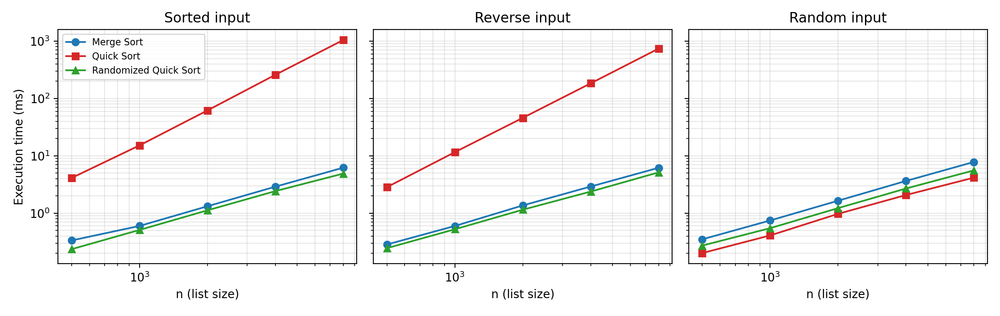

# MSCS532 Assignment 2: Merge Sort vs. Quick Sort

This project implements two divide-and-conquer sorting algorithms in Python,
following *Introduction to Algorithms* (Cormen et al., 4th ed.), and measures
how they behave on sorted, reverse-sorted, and random input.

| File | Contents |
|---|---|
| `merge_sort.py` | MERGE-SORT and MERGE (Chapter 2) |
| `quick_sort.py` | QUICKSORT with Lomuto PARTITION (Chapter 7), plus RANDOMIZED-QUICKSORT |
| `test_sorts.py` | Unit tests for all three sorts |
| `benchmark.py` | Measures execution time and peak memory, writes a CSV and graphs |
| `results/` | `results.csv`, `time.png`, `memory.png` from the last full run |

## Theory in one table

| | Best | Average | Worst | Extra space | Stable |
|---|---|---|---|---|---|
| Merge Sort | Θ(n lg n) | Θ(n lg n) | Θ(n lg n) | Θ(n) | yes |
| Quick Sort (last-item pivot) | Θ(n lg n) | Θ(n lg n) | Θ(n²) on sorted or reverse input | O(lg n) stack | no |
| Randomized Quick Sort | Θ(n lg n) | expected Θ(n lg n) | Θ(n²), but with vanishing probability | O(lg n) stack | no |

Recurrences:

```
Merge Sort:           T(n) = 2T(n/2) + Θ(n)      ->  Θ(n lg n)   (master theorem, case 2)
Quick Sort, balanced: T(n) = 2T(n/2) + Θ(n)      ->  Θ(n lg n)
Quick Sort, worst:    T(n) = T(n-1) + T(0) + Θ(n) ->  Θ(n²)
```

The Quick Sort here recurses into the smaller partition and loops on the
larger one. That keeps the call stack at O(lg n) depth so the Θ(n²) worst
case can be timed without hitting Python's recursion limit; it does not
change the number of comparisons.

## Requirements

Python 3.8 or later. The sorts and tests use only the standard library;
`benchmark.py` needs `matplotlib` to draw the graphs:

```bash
pip install matplotlib
```

## Running the code

```bash
python3 merge_sort.py
python3 quick_sort.py
python3 -m unittest -v test_sorts
python3 benchmark.py          # full run, about 15 seconds
python3 benchmark.py --quick  # small sizes only
```

## Results (Python 3.13, Apple Silicon, median of 5 runs)

| n = 8000 | Sorted | Reverse | Random |
|---|---|---|---|
| Merge Sort | 6.2 ms | 6.2 ms | 7.8 ms |
| Quick Sort | 1047.5 ms | 741.7 ms | 4.2 ms |
| Randomized Quick Sort | 4.9 ms | 5.2 ms | 5.6 ms |

Peak extra memory at n = 8000 was about 63 KiB for Merge Sort (the temporary
halves in MERGE) and about 1 KiB for either Quick Sort.



Key observations:

- Quick Sort with a fixed last-item pivot hits its Θ(n²) worst case on sorted
  and reverse-sorted input: doubling n multiplies the time by about 4.
- On random input that same Quick Sort is the fastest of the three, even
  though Merge Sort has the same Θ(n lg n) bound, because PARTITION does less
  copying than MERGE.
- Choosing the pivot at random removes the dependence on input order.
- Merge Sort's time barely changes with input order, as the analysis predicts.
